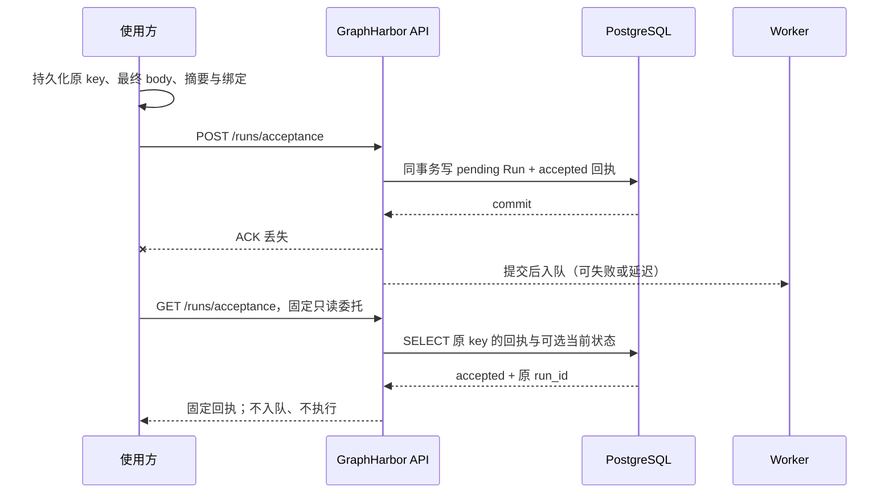

# Run 接受回执实施方案

> 状态：方案已获用户批准并完成，任务13/13、done；双包post45已直接发布，正式源安装与使用方复验通过，B01解除。进度以 [tasks.md](tasks.md) 为准，实际结果见 [verification.md](verification.md)。

## 1. 问题、证据与边界

典型窗口：使用方先持久化请求意图 → HTTP 创建 Run → 引擎提交 pending Run → ACK 丢失 → 使用方尚无 run_id → Worker 未运行或执行前发生 Stop/撤权。webhook 必须等到终态，graph guard 必须等到调度，均不能覆盖整个接受窗口。

现有代码事实：

- `langhost/core_api.py::runs_create()` 接受 header/body 幂等 key，通过 `scoped_idempotency_key()` 按 subject 绑定，再调用 `RunRepository.create()`；提交后安排 Redis 入队。
- `run_store.py::RunRepository.create()` 已有 Thread 行锁和 Run 幂等唯一索引，但仅比较 Thread/assistant，不比较请求内容。Run 删除后 key 记忆随 Run 消失。
- `database.py::connect()` 管理 commit/rollback，after-commit 入队失败不回滚已提交 Run。新回执必须进入这个事务，不能建立第二个独立提交窗口。
- 普通 Run list/get 继承 Thread 授权；`in_principal_scope()` 目前不实现隔离。新接口不能把该函数或 Auth 缺省 `{}` 当作跨 scope 隔离依据。
- 平台的 `background:<event_id>` 是业务预留 key，实际传给引擎的是 `platform:` 加 `[project_id, thread_id, key]` 的 SHA256。平台已有 `request_digest` 是业务 command 摘要，并非最终上游 body 摘要。

上一轮使用 LangChain docs/reference 工具核对了官方 [创建后台 Run](https://docs.langchain.com/langsmith/agent-server-api/thread-runs/create-background-run)、[Run list](https://docs.langchain.com/langsmith/agent-server-api/thread-runs/list-runs)、[Run get](https://docs.langchain.com/langsmith/agent-server-api/thread-runs/get-run)、[Auth](https://docs.langchain.com/langsmith/auth#supported-actions)、[webhook](https://docs.langchain.com/langsmith/use-webhooks) 和 [changelog](https://docs.langchain.com/langsmith/agent-server-changelog)。公开列表只有 limit/offset/status/select，无 metadata 服务端过滤；返回 metadata 可分页正向匹配。`if_not_exists` 管 Thread 创建，不能当作 Run 接受回执。

还核对了本地 `langgraph-api==0.13.0` 和 PyPI wheel 中的 `0.16.0`、`0.17.0rc1` 源码，未发现本项目所需的 Run key/receipt 接口。后两者核查 SHA256 分别为 `d19830eed8b835c52836dc78b123fbf9d4b775fb0f45d039a7e3ecfc8062f15f`、`7a9ec2d73353a9515795748ef6dc45159d31d4495470fafa13b45c654382554b`；这是调研基线，不是未来官方版本的能力承诺。

### 首版范围

- 仅现有 Thread 的异步后台 Run 创建和固定接受回执查询；使用通用 assistant/input/config/context/metadata 等既有概念。
- 普通 `/runs`、`/threads/{thread_id}/runs`、stream/wait/batch、Cron 和协议 run.start 保持现有契约，不自动启用新保证。
- 不添加业务 tenant/project/event/model/tool 字段，不扩展执行权限，不创建通用事件中心、通知系统或二次 Run 状态机。
- 不修改已有取消、终态 webhook 的语义。accepted 证明持久接受，不保证开始、成功、计费次数、通知完成或停止确认。

## 2. 双包与使用方职责

| 层 | 责任与落点 |
|---|---|
| `graphharbor` | 新 HTTP 路由、raw body/headers 校验、SDK Auth 调用、响应过滤和 OpenAPI；`langhost/run_acceptance.py`（新增）、`core_api.py`、`server.py` |
| `graphharbor-runtime` | 通用摘要/固定绑定、独立 ledger、唯一约束、事务内接受/拒绝、防重与有界维护；`run_acceptance.py`（新增）、`models.py`、`run_store.py`、`auth.py`、`authorization.py`、`production_worker.py`、additive migration |
| Platform API | 保存最终传输事实、正式 adapter、固定回执 token 签发、只读 reconcile、既有 RunRequests 回填；不直读引擎 SQL |
| Runtime 应用 | 验证委托和业务原 scope，撤权后只读例外、Stop 抑制与精确取消、执行前 guard；引擎只接收 opaque 绑定 |



## 3. HTTP 契约 v1

### 3.1 独立入口

同一路径支持两种方法：

```text
POST /threads/{thread_id}/runs/acceptance
GET  /threads/{thread_id}/runs/acceptance
```

静态路径必须注册在 `/threads/{thread_id}/runs/{run_id}` 前。POST 复用 `runs_create()` 的现有验证、assistant/context/durability/checkpoint/runtime-context 和后台调度，不复制整条创建管线；只增加内部显式回执分支。

这是对总体方案的实施收紧：不依靠旧创建路径上的 opt-in header。旧引擎可能忽略未知 header，独立 POST 在不支持的引擎上只能 404/405，不能悄悄执行。使用方不得遇到 404/405 后降级为旧 POST。新的摘要 header 出现在普通创建、stream/wait/batch/协议写入口时，新版应在产生副作用前 422；这些调用仍不获得回执保证。

### 3.2 必需请求字段

| 字段 | 规则 |
|---|---|
| `thread_id` | 规范小写 UUID；Thread 必须已存在，不支持隐式创建 |
| `Idempotency-Key` header | 原最终上游 key；1–256 个可见 ASCII 字符，不接受空白/控制字符、多个同名 header 或自动 trim |
| `GraphHarbor-Request-Digest` header | 严格 `sha256:` 加 64 位小写十六进制；POST 服务端从 raw body 重算，GET 与可信目标及持久记录比较 |
| POST body | `Content-Type: application/json`、无压缩UTF-8 JSON object；复用现有公开后台创建字段，拒绝重复JSON key、NaN/Infinity、非object和私有runtime-context字段 |
| GET body/query | 不接受 body 和 query 参数，不携带 input/config/metadata，不支持分页或范围查询 |

新 POST 不允许 body 内的 `idempotency_key`，即使与 header 相同也 422；`if_not_exists` 只允许省略或 `reject`，`create` 必须 422。禁止把绑定或回执控制字段放入 config/metadata。普通接口的既有 key 优先规则不在本项目改变。

### 3.3 请求摘要协议

摘要采用 **最终 JSON 字节摘要**，不引入跨语言 JSON canonicalization：

```text
request_digest = "sha256:" + lowercase_hex(SHA256(raw_utf8_json_body))
key_sha256     = lowercase_hex(SHA256(exact_ascii_idempotency_key))
```

SHA256 不包含 method、path、key header、Authorization 或其他 HTTP header；Thread/key/scope/credential 分别在 ledger 和可信委托中绑定。它覆盖 body 中实际存在的全部字段，包括 metadata/config/context 和默认参数。服务端必须在解析和 Auth 修改 metadata、合并 assistant defaults、注入服务器签名上下文之前重算摘要。

使用方负责最后一步序列化：公开字段白名单和所有默认值装配完成后，使用 `json.dumps(..., ensure_ascii=False, allow_nan=False, separators=(",", ":"))` 编码 UTF-8，一次保存后通过 HTTP `content=bytes` 发送；不得再交给 SDK/`json=payload` 重编码。这不是 canonical JSON：键顺序、空格、Unicode 转义、数值表示、null 与缺省、数组顺序变化都会改变摘要。实现必须有固定向量覆盖这些差异；等价 JSON 字节变化也属于改请求，原 key 返回 409。

引擎不保存 raw body/input/Authorization，只存摘要和授权 metadata 快照。使用方保存 body 的字段使用其已有敏感配置保护策略，禁止保存 bearer token、输出到日志或写进本项目证据。

### 3.4 查询与响应

POST 首次接受、已提交的忙碌拒绝及同 key/同摘要重放均返回 HTTP 200，内容为扩展回执；通过 `result` 区分接受与持久否定：

```json
{
  "schema_version": 1,
  "result": "accepted",
  "thread_id": "11111111-1111-1111-1111-111111111111",
  "key_sha256": "<64 hex>",
  "request_digest": "sha256:<64 hex>",
  "run_id": "22222222-2222-2222-2222-222222222222",
  "accepted_at": "2026-10-10T00:00:00Z",
  "observed_at": "2026-10-10T00:00:01Z",
  "details_expires_at": null,
  "run_state": {"available": true, "status": "pending"},
  "reason": null
}
```

所有响应设置 `Cache-Control: no-store`。不返回 raw key、scope/credential、授权快照、kwargs/input、Run metadata、执行输出或签名上下文。

GET 对被授权的固定目标返回 HTTP 200，三态如下：

| result | run_id / 时间 / run_state | 允许结论 |
|---|---|---|
| `accepted` | 原 run_id/accepted_at；Run 仍在时只读当前 status，否则 `available=false,status=null` | 原请求已持久接受；Run/Thread 删除不推翻这个事实 |
| `definitively_not_accepted` | run_id/accepted_at/run_state 为 null；reason=`multitask_rejected` | 已有持久拒绝且原 key 永久封住，不存在该 key 的接受路径 |
| `unknown` | run_id/accepted_at/run_state 为 null；reason=`no_receipt` 或 `receipt_expired` | 无足够有效证据；不允许据此自动 POST、换 key 或渲染为已取消/已失败 |

`details_expires_at` 在 pending/running 和终态尚未被维护任务观察时为 null；有期限时为明确 UTC 时间。`observed_at` 是数据库观测时间，原生状态只是这个时刻的快照，不是停止确认。unknown 不暴露已清除的详情。

### 3.5 错误与持久否定

| HTTP | 情况 | 是否可视为未接受 |
|---|---|---|
| 401/403 | 身份、固定目标、权限或必要 Auth handler 不满足 | 否；不能以拒绝回查证明此前没接受 |
| 404 | 授权过滤后的记录/资源不可见，或旧引擎无新路由 | 否；使用方保留 unknown |
| 422 | 缺 key/摘要、raw digest 不符、非法 JSON、非法入口或字段 | 只说明这次调用被拒绝，不提供该 key 的持久否定 |
| 409，`receipt_request_conflict` | 同绑定/key 的 Thread 或请求摘要发生变化 | 否；不修改既有回执，不暴露旧目标详情 |
| 409，`receipt_expired` | POST 命中已过期详情/墓碑 | 否；永久防重，不能创建新 Run |
| 200，回执 result=`definitively_not_accepted` | 授权、输入等检查通过后，`multitask_strategy=reject` 因 Thread 忙碌被拒绝，拒绝已提交 | 是，但仅针对被永久封住的同 key；随后同 key POST 仍返回这份拒绝 |
| 503/断连/超时 | 数据库、签名、checkpoint 或提交/网络失败 | 否；必须 GET 原 key 对账 |

首版不承诺为所有校验、鉴权和资源错误写拒绝记录。唯一持久拒绝原因是明确分类的 `multitask_rejected`；为 `RunConflictError` 增加结构化原因，不能匹配错误字符串，也不能把幂等目标冲突误写为未接受。

## 4. 可信身份与只读委托

### 4.1 通用 Auth 返回值

只有应用的 `@auth.authenticate` 验证身份后返回的下列字段可以作为绑定源；客户端 body/header 不得直接定义它们：

```text
auth_user.run_acceptance = {
  scope_id: <64 lowercase hex>,
  credential_id: <64 lowercase hex>,
  operation: "create" | "read",
  thread_id: <canonical UUID>,
  key_sha256: <64 lowercase hex>,
  request_digest: "sha256:<64 lowercase hex>"
}
```

- `scope_id` 是应用的稳定 key 命名空间与原 actor 的 opaque 绑定，不能包含本次 Thread、body、event、JWT jti 或会变化的权限/策略版本；固定 Thread/digest 在 grant 中单独验证。`credential_id` 绑定原稳定 credential，而非每次 JWT 的 jti。两者均由应用生成，引擎不理解组成它们的业务字段。
- 首版新接口要求配置 SDK Auth、有效 Principal、完整绑定及显式可命中的授权 handler；匿名、缺失绑定、Auth 无 handler 时 403。普通开发匿名接口行为不改变。
- 请求 Thread/key/digest 必须与这个可信固定目标完全相同。收到这种 grant 的 Principal 由 middleware 限制到新路径：create 只允许该目标 POST/GET，read 只允许该目标 GET；其他 Run/state/store/assistant/logs/模型/MCP/Workspace/取消入口全部拒绝。
- 普通 read/create grant 按当前 ACL 走应用回调。专用内部 read grant 由应用在核对原业务记录后短期签发，可允许已撤权的固定回执清理，不能复用已过期/撤销的原 JWT 绕过 authentication。
- 需要精确取消找到的 Run 时，沿用应用既有固定 Run 取消委托；receipt-read token 本身没有取消权限。

在 `authorization.py::authorize()` 增加仅新路径使用的 `require_handler=True`，默认值保留旧行为，避免 SDK Auth 默认放行成为新读取通道的权限漏洞。

### 4.2 SDK Auth 事件与 metadata filters

继续使用官方已有 actions，不虚构官方 `runs/receipt` action：

- POST：`threads/create_run`，保留普通创建 value，并由服务端追加 `run_acceptance_receipt=True` 和固定 Thread/key_sha256/request_digest。
- GET：`threads/read`，只包含服务端生成的回执 marker 和固定目标，不携带客户端可控的执行参数。

marker 必须由新 handler 创建；body 中同名字段不产生权限。提交时保存 **已通过 create filters 的 Thread metadata 快照**。GET 和 POST 回执重放的 filters 必须进入这个快照上的 `metadata_predicate()` 查询，不能仅调用 Auth 然后忽略结果；不依赖仍然存在的 Thread 行。

完整详情被 metadata filters 排除时统一返回 404，不返回冲突或接受信息。没有记录、或固定绑定命中已过期墓碑时返回 unknown；墓碑仅证明这个 key 被封住，不保留用于历史资源读取的 metadata，也不能重新授予任何详情读取。

应用内部只读例外可返回匹配原 scope 的 filter，或在验证全部固定绑定后显式允许；引擎仍强制 scope/credential/Thread/key/digest。metadata 快照只支持历史资源隔离，不能替代应用对普通用户当前 ACL 的检查。详情清理后的墓碑不返回原 metadata 或 accepted 详情。

不同 scope/credential 不共享 key 命名空间；另一主体命名空间中无记录只能拿到 unknown，不能获得原主体的接受事实。联合安全验收须在签发层拒绝错 tenant/project/actor/credential 的内部委托，在引擎层拒绝固定目标篡改。

## 5. 独立 ledger 与原子接受

### 5.1 数据结构

新增 `RunAcceptanceRow`，表名 `run_acceptance_receipts`，无 Run/Thread 外键和级联删除。

| 列 | 内容/约束 |
|---|---|
| `receipt_key` | 64 hex，主键；按下面的固定协议由 scope/credential/key_sha256 生成 |
| `scope_id`, `credential_id`, `key_sha256` | 各 64 hex；唯一组合 `(scope_id, credential_id, key_sha256)`；不是业务 ID |
| `thread_id` | 非空 UUID，永久固定，不作为 key 命名空间的一部分；跨 Thread 重用同 key 409 |
| `request_digest` | 非空 71 字符，永久固定；原始 body 不入表 |
| `outcome` | `accepted` / `rejected` / `expired`；没有可提交的 reserved/dispatching 中间态 |
| `run_id`, `accepted_at` | accepted 非空；拒绝和 expired 为 null；accepted_at 是接受事务内的数据库时间，只有 commit 后记录可见才证明接受；run_id 无外键 |
| `rejection_reason` | rejected 时仅 `multitask_rejected`；其他状态为 null |
| `authorization_metadata` | 首次合法提交时的 Thread metadata 快照，仅完整详情期间保留，永不公开 |
| `recorded_at` | 数据库时间，用于拒绝期限与运维；不作为接受成功的替代证据 |
| `closed_observed_at`, `details_expires_at` | accepted 在观察终态/Run 缺失前为 null；rejected 立即设置 7 天期限；只由写入/维护路径修改 |

`expired` 行只保留固定绑定、Thread、摘要、outcome、必要时间，清除 run_id/accepted_at/reason/metadata 等详情。主键、唯一组合及最小墓碑永久保留；不能因为 Run/Thread 删除、TTL、rollback 或普通 prune 删除它。

固定列类型：四个hex标识用 `String(64)`，摘要用 `String(71)`，outcome用 `String(16)`，reason用 `String(32)`，ID用PostgreSQL UUID，时间用带时区timestamp，授权快照用JSONB。完整快照非空，expired快照为SQL NULL；recorded_at服务端默认数据库时间。表/列不加入业务字段。

增加两个有界维护索引：按 `recorded_at` 扫描 outcome=accepted 且 closed_observed_at 为空的行；按 `details_expires_at` 扫描尚有详情且到期的行。CHECK 固定三种 outcome 的字段组合，禁止 accepted 缺 run_id、rejected 带 run_id 或 expired 留下授权详情。

```text
receipt_key = SHA256(
  ASCII("graphharbor:run-acceptance:v1") + NUL +
  ASCII(scope_id) + NUL + ASCII(credential_id) + NUL + ASCII(key_sha256)
).hexdigest()
RunRow.idempotency_key = "receipt:v1:" + receipt_key
```

采用独立 namespace 保持现有 `auth:<subject-key-hash>` 行和匿名行为。切换前后的同业务事件不能分别经旧/新 namespace 提交；使用方必须先排空或隔离旧提交，已有无回执事件只做旧路径的正向找回。

migration 计划为 `013_run_acceptance_receipts`，父 revision 是当前 `012_run_callback_deliveries`；实施前若 head 已变化，顺延编号并调整依赖，不制造分叉。只 additive 建表/索引/CHECK，不回填旧 Run 的身份/摘要，不变更旧表约束。downgrade 不删 ledger：采用现有 migration012 的明确拒绝破坏性 downgrade 模式。

### 5.2 新 POST 事务

1. Middleware 完成真实身份验证和固定 grant 的方法/路径限制；handler 校验 raw body、唯一 headers、digest 与固定目标。
2. 使用 SDK Auth 的 create_run handler 验证当前提交权限，生成可信 marker 与 metadata filters；此时不要求仍有 Thread/assistant 行，便于历史回执回放。
3. 同一个 `connect()` 事务先按 `receipt_key` 取 PostgreSQL transaction-level advisory lock；固定顺序 **key → Thread → 新 Run**。64 位 lock hash 碰撞只多串行，不决定身份；持久唯一约束才是事实源。
4. 查询 ledger。授权且同 Thread/摘要的 accepted/rejected 直接回放，不修改 Run、签名、TTL、metadata，不再入队；冲突/expired 409。已存在 ledger 的路径不能再锁 Run/Thread，避免与 Worker 的 Run→Thread 锁顺序成环。
5. 无 ledger 才继续现有 assistant/read、Thread、input、durability、interrupt、checkpoint 等验证；Thread filters 与授权快照在 Thread 行锁内读取，不能保存锁外的旧 metadata。在同事务内使用上述 receipt namespace 创建 pending Run、生成可信 runtime-context 签名、写 accepted 详情及授权快照。
6. 仅明确的 Thread busy 拒绝写 rejected 详情并 commit，且这个 key 后续再也不能接受。其他异常 rollback，不写假否定；签名失败等必须使 Run 与回执同时回滚。
7. 成功 commit 后才发送响应，仅首次 accepted 注册 `schedule_after_commit(enqueue_run)`。重放、GET、拒绝、expired/conflict 没有入队 callback。

如果发现 receipt namespace 的 Run 已存在而 ledger 缺失，这是完整性故障，返回 503/unknown 并停止该 key 创建；不能从缺少摘要/绑定证据的 Run 反推新回执。数据库唯一冲突或 deadlock 应整体 rollback 后按原 key重查，不能留一个 Run 再另开事务补回执。

Run insert 后发生的异常必须越过 `connect()` 的 rollback 边界，再转换成 HTTP 错误；不能在事务内简单 `return _error(...)` 让上下文正常退出并提交半份结果。首次接受的提交失败同样不得先回包。

### 5.3 并发和迟到请求

两个 API 使用同一 scope/credential/key，即使 Thread 不同也先串行 key；只有一个 accepted 或 rejected 槽位。同 key 换 body/Thread 409，同 key 同 body 返回同一 run_id，Redis enqueue 只注册一次。

GET 不拿 advisory/行写锁，只读已提交数据；看到尚未提交或不存在的记录返回 unknown。这个结果不对在途原 POST 加栅栏，原请求随后仍可能提交 accepted。持久 rejected 必须和同 key 封锁一起提交，才能提供 `definitively_not_accepted`；HTTP 没记录的拒绝不具备这种证明。

## 6. 只读查询与保留维护

GET 顺序为 authenticate/固定目标校验 → threads/read回调 → 按binding/key SELECT并应用授权快照filters → 校验记录Thread/digest → 可选读取同时匹配原run_id/thread_id的Run `status`。同绑定/key而目标不符返回409，不泄露原目标；不是用额外的digest筛选把冲突误当no_receipt。整个路径不得创建/更新任何记录、延长TTL、加lease、入队、调模型/工具、触发webhook或恢复审批。查询事务结束本身不是业务写入。

详情默认保留策略：

- accepted 且 Run pending/running：保持完整回执，不因长排队、Worker=0 或长执行耗尽一个“接受后固定 7 天”窗口。
- 维护首次观察原生终态且lease_owner为空，或Run行已删除：写一次 `closed_observed_at`，设置 `details_expires_at=该时间+保留秒数`；以后不延期。使用现有 `is_terminal()` 分类；这只确定详情保留窗口，不向使用方声称停止确认。
- rejected：拒绝事务直接设置 `details_expires_at=recorded_at+保留秒数`。
- 到 deadline：GET 返回 `unknown/receipt_expired`，POST 409；即使物理清理延迟也不能继续返回完整详情。维护将行转成 expired 墓碑。
- 现有 retry/drain 仍以原 Run 的 pending/running 为准，不清理活跃 Run 的详情；若已记录过终态期限，活跃期间暂不适用该期限，GET 只观察，不改期限。维护清理时复核 Run 状态，并以短 Run 行锁防止与回到 pending 的迁移竞争。
- Worker/维护暂停只会让“终态第一次被观察”的时间延后，保留期是下限；GET 不替代维护，也不写 observed/TTL。

复用 `ProductionWorker._reaper_loop()`，新增有界 `maintain_acceptance_receipts()`：每轮最多1000个实际可关闭/清理的候选，每批独立短事务、`SKIP LOCKED`。通过Run终态/缺失条件过滤后才limit，不能总取最旧1000个活跃回执导致后续终态饥饿；期限维护不锁Thread、不调用Run迁移。分别处理尚未关闭的accepted和到期详情，失败不阻断lease reaper。使用数据库时钟，配置 `GRAPHHARBOR_RUN_ACCEPTANCE_RETENTION_SECONDS`，默认604800，只允许正整数；部署值必须覆盖使用方最长通知与Stop对账期限。

首版不增加消费者 ack、手工刷新 TTL、重新执行或删除墓碑 API。存储成本随历史 key 数量线性增长，TTL 仅压缩详情，不能把“永久防重”和“整行到期删除”同时承诺。备份/恢复必须包含 ledger；恢复到接受前快照会失去防重事实，需要暂停受管提交并做人工对账，不能声称跨数据丢失的 exactly-once。

## 7. 使用方接线

使用方交付仓库为 `../ai-agent-platform`，实际开发使用其登记 Worktree；用户已批准 U01–U03 的接线、隔离验证及正式源依赖更新。

### 7.1 发送前保存最终传输事实

`RuntimeGatewayService.launch_runtime_run()` 在完成 context/model reference/completion marker/config/默认字段和 adapter 白名单后，先持久保存：

- 实际 `upstream_idempotency_key`，不是重新使用 `background:<event_id>`。
- 最终 `upstream_body` 字节及 `upstream_request_digest`；保留已有业务 `request_digest` 字段，不能覆盖混用。
- 原 `scope_id/credential_id` 与引擎 Thread、原 actor/credential/scope 的固定关联。

在 `RunRequestRecord`/`StoredRunRequest` 增加 nullable additive 字段，新请求发送前必须填满；旧记录缺字段保留旧正向找回能力，不重建变化后的 body/defaults，不迁移猜测摘要。准备函数负责先完成最终序列化，再保存，再发送；adapter 不得在保存后追加默认值。HTTP token 可刷新，但固定原 credential 绑定不变。

字段至少为 `upstream_idempotency_key`、`upstream_body`、`upstream_request_digest`、`upstream_receipt_scope_id`、`upstream_receipt_credential_id` 和 `upstream_auth_snapshot`。最后一项保存可信原principal/policy的非secret快照，沿用既有委托必需字段，不保存JWT；内部联系只读回查从它签发专用委托，不重新调用当前模型授权构建函数。真实字段类型与平台敏感存储机制由使用方迁移落实。

使用方绑定计算冻结为UTF-8 JSON紧凑数组的SHA256：`scope_id=hash(["platform:run-receipt-scope:v1", tenant_id, project_id, original_actor_id])`；service-account的 `credential_id=hash(["platform:run-receipt-credential:v1", "service-account", original_credential_uuid])`，人类用户则用 `[同域字符串, "user", original_actor_id]`。读取时只能从原持久记录恢复，不允许从这次来访者重新选actor/credential；Thread/assistant/event/source仍在应用固定目标核对中单独约束。

最终body序列化并持久后，签发run-create委托时追加已签名 `run_acceptance` 固定grant；它在Authorization header内，不塞回body，避免摘要循环。issuer/verifier共同支持这个可选claim，只有operation=run-create时映射引擎create，专用run-acceptance-read映射read；运行时认证回调不得照抄未经签名验证的请求字段。

RunRequests 回填只能绑定原 run_id，已有不同 run_id 冲突不得覆盖。ACK 落盘前 crash 后依靠同一组持久传输事实回查，不依靠进程缓存。

当前 `launch_runtime_run()` 把所有4xx标记rejected；新路径必须改成只识别验证通过的 `definitively_not_accepted` 持久回执。404/405、401/403、422、普通409、网络错误继续unknown/保留原状态，不能推断此前没接受或触发新提交；普通foreground路径的错误分类不在此处扩大修改。

### 7.2 Adapter 与 reconcile

在 `RuntimeGatewayUpstreamProtocol` / `LangGraphRuntimeGatewayUpstream` 增加明确方法：

```text
create_run_with_acceptance(thread_id, body_bytes, idempotency_key, request_digest)
get_run_acceptance(thread_id, idempotency_key, request_digest)
```

新增 transport byte 方法，使用 `LangGraphRuntimeClient` 的同一 base_url、错误转换和 forwarded headers；receipt headers 由该方法明确设置，Authorization 沿用真实验证的委托。不能把控制字段藏在 SDK `_CREATE_FIELDS`、动态 kwargs 或 use case 内 SQL。

`background_completion.py::deliver(reconcile_only=True)` 只调用GET，严格校验回执Thread/key_hash/digest后保存accepted/run_id。它不能走 `launch_runtime_run()`、模型引用重建、write ACL获取、create adapter或任意POST。未支持新路由或旧无绑定记录，仅在当前read ACL下分页list正向找回metadata匹配；找不到/不能读/404/超时均unknown，不能用前100条没匹配作为负证据。降级首版固定每页100、最多10页/次，达到预算仍无匹配就是unknown；不用SDK列表无服务端metadata过滤的事实构建假否定。

### 7.3 Runtime 撤权与 Stop

应用签发和验证 `run-acceptance-read` 委托，必须核对原 event/source/actor/credential、原 scope、Thread/key_hash/引擎摘要和记录来源。认证回调据此返回上文通用 grant；业务字段留在应用的 token/记录/回调里。

`authorize_completion_cleanup()` 为缺 run_id 的固定回执增加只读例外；`auth/platform.py` 只在服务端 receipt marker、threads/read 和目标全部匹配时放行，不能放宽普通 read 或 create_run。浏览器继续当前 ACL，内部清理通道才可撤权后签发短 TTL 固定委托。

`deliver_completion()` 不切换 event/key、不 POST；`finish_delivery()` 找到 run_id 后保持 Stop 已有 suppressed，不恢复通知。它将原 run_id 交给既有精确取消链路；Stop 从 unconfirmed 到 confirmed 必须沿用既有持久 stopped/清理依据，不能拿 receipt.accepted 或 Run status 单独充当确认。执行前 graph guard 继续保留。

## 8. 发布、切换与回退

1. 完成源代码和独立 PG/Redis 验收；migration 实施先在可丢弃测试库验证，真实数据库操作不属于本次规划。
2. 创建双包同版本四产物，版本号在正式准备时从已发布基线选唯一值，不在规划中提前提升。记录源码来源、wheel/sdist hashes，冷安装验证，不清理已有 dist 或工作树。
3. 使用方新增持久字段，部署具备新 Auth 接线的应用；固定 API/Worker 实例版本，OpenAPI 新路径和真实无副作用 GET 都验证。OpenAPI/版本探测不构成任何 key 的接受证据。
4. 停止旧受管后台新提交，隔离旧 unknown/inflight；切换后仅新路径，所有接收受管 POST 的 API 必须支持新模式。普通 foreground/Cron 不迁移。
5. 经过正式 PyPI 双包独立安装、使用方正式锁接入和联合故障矩阵，才可解除 B01。2026-10-10 用户明确要求验证后使用本地 key 直接上传双包，发布授权已成立；现役升级和 git commit/push/tag 未授权。

混合版本门禁：旧 API 对新 POST 404/405，零新执行；新 API+旧 Worker 对接受回执仍成立，但维护延后，不宣称 Worker 新功能具备；新 API 两实例共享 ledger 必须一致。负载均衡命中不同版本不能使使用方退回旧 POST。

回退先冻结受管新提交与调度，保存 ledger/墓碑和平台记录，再退匹配双包/应用版本。旧代码继续运行时新查询可能不可用，使用方保留 unknown/inflight/suppressed；不得删表、重发、恢复被 Stop 的通知。恢复新版时继续查原 key。数据库备份回滚或旧/新 namespace 混投不在强保证范围，必须人工处理。

## 9. 完成标准

引擎完成必须同时具备协议、严格绑定、Run+receipt 原子提交、负证据栅栏、纯 SELECT、删除/过期后的防重、旧接口回归和发行包两进程证据。使用方完成还要求撤权回查、queued Stop、ACK 落盘前 crash 与正式依赖接入，并将 B01 状态同步到来源专项。

测试设计只用确定性 graph/计数器和独立临时 PG/Redis，覆盖模型/MCP/Workspace 零动作；本项目无需真实模型费用来验证接受事实。32 项具体场景、命令与 Phase/Final 规则见 [verification.md](verification.md)。
